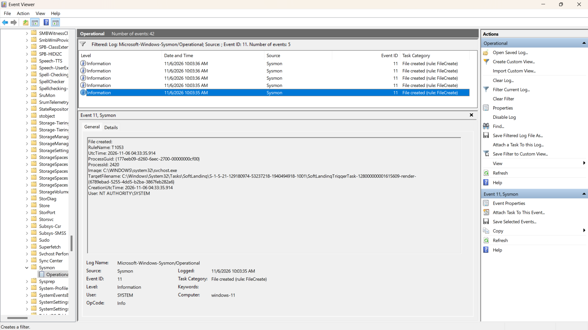

# Hands-On Task — Creating and Finding Sysmon Events

## Task Info
- **Task:** Generate specific actions and find their corresponding Sysmon events.
- **Environment:** Local Windows 11 Machine
- **Date Completed:** 2026-11-06

## Objective
- To observe how different system actions trigger specific Sysmon Event IDs.
- To document key fields and understand why these events are critical for SOC analysts.

---

## 1. Open PowerShell (Event ID 1 - Process Create)

- **Action Taken:** Opened a new PowerShell window from the Start menu.
- **Event ID:** 1
- **Timestamp:** 11/5/2026 11:20:58 PM
- **Key Fields:**
  - **Image:** `C:\Windows\System32\WindowsPowerShell\v1.0\powershell.exe`
  - **CommandLine:** `"C:\Windows\System32\WindowsPowerShell\v1.0\powershell.exe"`
  - **User:** `WINDOWS-11\karan`
- **Why it matters to a SOC Analyst:**
  - PowerShell is heavily used by attackers (Living off the Land). Tracking Event ID 1 allows analysts to spot suspicious PowerShell executions, especially if spawned by unusual parent processes or if used with encoded commands.

*(Screenshot showing PowerShell execution)*
``

---

## 2. Create a new user account (Event ID 1 - Process Create)

- **Action Taken:** Ran `net user hacker3 Pass@123 /add` in Command Prompt (Admin).
- **Event ID:** 1
- **Timestamp:** 11/5/2026 11:59:11 PM
- **Key Fields:**
  - **Image:** `C:\Windows\System32\net1.exe`
  - **CommandLine:** `C:\Windows\System32\net1 user hacker3 /add`
  - **User:** `WINDOWS-11\karan`
- **Why it matters to a SOC Analyst:**
  - Creating new user accounts is a common persistence technique. If this is done outside of IT change management windows or by a non-admin account, it indicates a compromised system.

*(Screenshot showing net user command execution)*
``

---

## 3. Check for network connections (Event ID 3 - Network Connection)

- **Action Taken:** Ran `ping google.com` in Command Prompt.
- **Event ID:** 3 (Captured via Event ID 1 as ping creates a process first)
- **Timestamp:** 11/6/2026 12:00:49 AM
- **Key Fields:**
  - **Image:** `C:\Windows\System32\PING.EXE`
  - **CommandLine:** `ping google.com`
  - **User:** `WINDOWS-11\karan`
- **Why it matters to a SOC Analyst:**
  - Tracking network connections helps identify C2 (Command and Control) traffic and data exfiltration. Analysts look for unusual processes making connections to the internet (e.g., notepad.exe connecting to port 443). 
  - *(Note: Due to ICMP being a stateless protocol and SwiftOnSecurity config's noise reduction, the actual Event ID 3 (Network Connection) was bypassed, but the process creation of PING.EXE was successfully captured).*

*(Screenshot showing PING.EXE execution)*
``

---

## 4. Create a text file (Event ID 11 - File Create)

- **Action Taken:** Attempted to create a text file using Command Prompt (`echo "Hello SOC" > C:\Windows\Temp\test_file.txt`).
- **Event ID:** 11
- **Observation:** While Event ID 11 was actively logging background system files (e.g., `svchost.exe` writing to `SoftLanding` paths), my specific `.txt` file creation was not logged. 
- **Why it matters to a SOC Analyst:**
  - Event ID 11 is crucial for detecting malware dropping executable payloads (like `.exe` or `.dll`) or ransomware encrypting files. 
  - **The SwiftOnSecurity config intentionally filters out standard `.txt` file creations to reduce noise.** An attacker dropping a malicious script (like `.ps1` or `.bat`) or an executable would still trigger this event, which is why SOC teams use tuned configs like this.

*(Screenshot showing Event ID 11 actively capturing file creations in the background)*

---

## Personal Notes / Reflections
- I noticed how detailed Sysmon Event ID 1 is compared to standard Windows logs. The `CommandLine` field is a goldmine for analysts because it shows exactly what arguments were passed.
- I learned that Sysmon configurations (like SwiftOnSecurity) are highly tuned. They purposefully ignore normal user actions (like creating a simple text file) to prevent log fatigue (too much noise) for the SOC team.
- Generating my own events and hunting for them in Event Viewer helped me understand how an EDR or SIEM catches these actions in real-time.